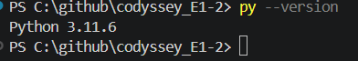

# Codyssey_E1-2
# 🎯 나만의 퀴즈 게임

## 1. 프로젝트 개요

Python을 활용하여 제작한 콘솔 기반 퀴즈 게임입니다.

사용자는 주제별 퀴즈를 풀고, 새로운 퀴즈를 추가하며, 자신의 최고 점수를 확인할 수 있습니다.

퀴즈 데이터와 최고 점수는 JSON 파일에 저장되므로 프로그램을 종료하고 다시 실행해도 데이터가 유지됩니다.

## 2. 주제 선정 이유

Python 기초 문법과 객체지향 프로그래밍을 실습하기 위해 퀴즈 게임을 프로젝트 주제로 선정했습니다.

클래스, 함수, 조건문, 반복문, 예외 처리 및 JSON 파일 입출력을 실제 프로그램에 적용하여 Python 프로그래밍의 기본 개념을 익히고자 했습니다.

## 3. 개발 환경

| 항목 | 사용 환경 |
|---|---|
| 프로그래밍 언어 | Python 3.10 이상 |
| 개발 도구 | Visual Studio Code |
| 운영 환경 | Windows / PowerShell |
| 버전 관리 | Git |
| 원격 저장소 | GitHub |
| 데이터 저장 | JSON |
| 라이브러리 | Python 표준 라이브러리 |

## 4. 실행 방법

### 4-1. 저장소 복제

```bash
git clone https://github.com/jeongb959-ai/codyssey_E1-2.git
```

### 4-2. 프로젝트 폴더 이동

```bash
cd codyssey_E1-2
```

### 4-3. 프로그램 실행

```bash
py main.py
```

## 5. 주요 기능

### 5-1. 퀴즈 풀기
- 등록된 퀴즈 출제
- 선택지를 통한 정답 입력
- 정답 및 오답 확인
- 정답 해설 출력
- 점수 계산 및 최고 점수 갱신

### 5-2. 퀴즈 추가
- 퀴즈 주제 입력
- 질문 및 선택지 입력
- 정답 번호 입력
- 정답 해설 입력
- 새로운 퀴즈 등록 및 저장

### 5-3. 퀴즈 목록
- 등록된 퀴즈 전체 확인
- 퀴즈 주제 및 질문 확인

### 5-4. 점수 확인
- 최고 점수 확인
- 퀴즈 플레이 결과 확인

### 5-5. 데이터 관리
- JSON 파일에 퀴즈 데이터 저장
- JSON 파일에서 데이터 불러오기
- 프로그램 재실행 후 데이터 유지
- JSON 파일이 없거나 손상된 경우 기본 퀴즈로 실행

### 5-6. 예외 처리
- 잘못된 메뉴 입력 처리
- 숫자가 아닌 입력 처리
- 빈 입력 처리
- 입력 범위 검증
- Ctrl+C 및 EOFError 발생 시 안전 종료

## 6. 파일 구조

```text
codyssey_E1-2/
├── main.py
├── quiz.py
├── quiz_game.py
├── state.json
├── README.md
├── .gitignore
└── docs/
    └── screenshots/
        ├── JSON 데이터 저장.png
        ├── main, quiz.py 등 표시 화면.png
        ├── PowerShell에서 py main.py 실행.png
        ├── Python 코드가 작성된 화면.png
        ├── 깃_버전.png
        ├── 점수 확인.png
        ├── 퀴즈 게임 메뉴 1~5번 표시.png
        ├── 퀴즈 목록 확인.png
        ├── 퀴즈 추가.png
        ├── 퀴즈 플레이.png
        ├── 파이썬_버전.png
        ├── git commit.png
        └── git branch merge.png
```

※ `git branch merge.png`는 브랜치 목록과 병합 기록을 촬영한 후 추가합니다.

## 7. 주요 클래스 및 객체지향 설계

### 7-1. Quiz 클래스

퀴즈 하나의 정보를 관리하는 클래스입니다.

- 퀴즈 주제 관리
- 질문 관리
- 선택지 관리
- 정답 및 해설 관리
- 정답 확인
- 퀴즈 데이터를 Dictionary 형태로 변환
- Dictionary 데이터를 Quiz 객체로 변환

### 7-2. QuizGame 클래스

퀴즈 게임 전체 기능을 관리하는 클래스입니다.

- 기본 퀴즈 생성
- 퀴즈 추가 및 목록 출력
- 퀴즈 플레이
- 정답 및 점수 계산
- 최고 점수 관리
- JSON 데이터 저장 및 불러오기

### 7-3. 객체지향 프로그래밍을 선택한 이유

본 프로젝트에서는 퀴즈 데이터와 게임 운영 기능을 구분하여 관리하기 위해 객체지향 프로그래밍을 적용했습니다.

함수 중심으로 구현하면 퀴즈 데이터와 관련된 값들을 여러 함수에 전달해야 하고, 데이터가 많아질수록 함수 간 의존 관계가 복잡해질 수 있습니다.

반면 클래스를 사용하면 퀴즈의 데이터와 관련 기능을 하나의 객체로 묶을 수 있으며, 게임 운영 기능도 QuizGame 클래스에서 관리할 수 있습니다.

이를 통해 코드의 역할과 책임을 명확하게 구분하고, 기능 추가 및 유지보수를 쉽게 할 수 있습니다.

다만 작은 규모의 프로그램에서는 클래스와 메서드가 늘어나 구조가 복잡해질 수 있으므로 프로그램의 규모와 목적에 맞게 사용하는 것이 중요합니다.

## 8. state.json 데이터 저장 및 관리

`state.json`은 프로젝트에서 사용하는 퀴즈 데이터와 최고 점수를 저장하는 파일입니다.

| 항목 | 설명 |
|---|---|
| quizzes | 등록된 퀴즈 목록 |
| best_score | 최고 점수 |

UTF-8 인코딩과 JSON 형식을 사용하여 한글 데이터도 저장할 수 있습니다.

프로그램을 실행하면 저장된 데이터를 불러오며, 퀴즈를 추가하거나 최고 점수가 갱신되면 파일에 변경 내용을 저장합니다.

### 8-1. JSON 저장 방식의 장점

- 별도의 데이터베이스 설치가 필요하지 않습니다.
- Python 표준 라이브러리로 쉽게 처리할 수 있습니다.
- 사람이 읽을 수 있는 텍스트 형식입니다.
- 소규모 프로그램의 데이터 저장에 적합합니다.

### 8-2. JSON 저장 방식의 한계

JSON 파일은 데이터가 많아질수록 파일 전체를 읽고 파싱하거나 다시 저장하는 작업에 시간이 더 걸릴 수 있습니다.

또한 데이터를 메모리에 불러와 처리하는 방식은 데이터 규모가 커질수록 메모리 사용량이 증가할 수 있습니다.

여러 사용자가 동시에 같은 JSON 파일을 수정하는 경우 데이터 충돌이나 저장 내용 유실이 발생할 가능성도 있습니다.

따라서 현재와 같은 소규모 콘솔 프로그램에는 JSON이 적합하지만, 데이터가 많아지거나 동시 접근이 필요해지는 경우에는 SQLite 또는 PostgreSQL과 같은 데이터베이스를 사용하는 것이 더 적합합니다.

## 9. 데이터 백업 및 복구 정책

### 9-1. 현재 데이터 복구 방식

프로그램은 `state.json` 파일이 없거나 JSON 형식이 손상된 경우 기본 퀴즈 데이터를 사용하여 실행하도록 구성되어 있습니다.

다만 기본 퀴즈로 실행하는 것은 기존 데이터를 백업하는 기능과는 다릅니다. 손상된 파일의 기존 데이터를 복구할 수 있다는 의미도 아닙니다.

### 9-2. 데이터 백업 권장 정책

데이터 손실을 방지하기 위해 다음과 같은 백업 정책을 적용하는 것을 권장합니다.

1. `state.json`을 수정하기 전에 기존 파일을 `state.json.bak`으로 백업합니다.
2. JSON 저장 중 오류가 발생하면 기존 백업 파일을 보존합니다.
3. JSON 파일이 손상된 경우 백업 파일의 JSON 유효성을 확인합니다.
4. 백업 파일이 정상이라면 백업 데이터를 복원합니다.
5. 백업 파일도 손상된 경우 기본 퀴즈 데이터를 사용합니다.

※ 위 내용은 백업 기능을 추가할 때 적용할 정책입니다. `.bak` 자동 생성 및 백업 파일을 통한 복구가 실제 코드에 구현된 후 구현 완료로 표시해야 합니다.

## 10. 요구사항 변경 시 수정 대상

주요 기능의 변경이나 추가가 필요한 경우 다음 파일과 클래스 및 메서드를 수정합니다.

| 변경 요구사항 | 수정 파일 | 수정 대상 |
|---|---|---|
| 메인 메뉴 항목 추가 | main.py | show_menu(), main() |
| 메뉴 입력 검증 변경 | main.py | get_menu_choice() |
| 퀴즈 추가 입력 방식 변경 | main.py | add_new_quiz() |
| 퀴즈 데이터 필드 추가 | quiz.py | Quiz.__init__(), to_dict(), from_dict() |
| 정답 판정 방식 변경 | quiz.py | check_answer() |
| 기본 퀴즈 추가 | quiz_game.py | 기본 퀴즈 초기화 부분 |
| 퀴즈 등록 기능 변경 | quiz_game.py | add_quiz() |
| 퀴즈 목록 출력 변경 | quiz_game.py | show_quizzes() |
| 퀴즈 출제 및 점수 계산 변경 | quiz_game.py | play_quiz() |
| 최고 점수 처리 변경 | quiz_game.py | update_best_score(), show_best_score() |
| JSON 저장 방식 변경 | quiz_game.py | load_state(), save_state() |
| 데이터 저장 항목 변경 | quiz_game.py, quiz.py | to_dict(), from_dict(), load_state(), save_state() |

※ 실제 코드의 메서드 이름과 일치하도록 작성한 매핑이며, 기본 퀴즈 초기화 부분의 실제 메서드명은 소스 코드와 대조하여 확인합니다.

## 11. Git 및 GitHub 버전 관리

Git과 GitHub를 활용하여 프로젝트 소스 코드를 관리했습니다.

- Git 저장소 초기화 및 원격 저장소 연결
- 기능별 커밋을 통한 변경 이력 관리
- 기능 개발 브랜치 생성
- 브랜치 작업 후 기본 브랜치에 병합
- GitHub 원격 저장소에 프로젝트 업로드
- `git clone`을 이용한 저장소 복제
- `git pull`을 이용한 원격 저장소 변경사항 가져오기

### 11-1. 커밋 메시지 작성 규칙

커밋 메시지는 변경 목적을 쉽게 파악할 수 있도록 다음 형식을 사용합니다.

```text
type: 변경 내용 요약
```

주요 접두사는 다음과 같습니다.

| 접두사 | 사용 목적 | 예시 |
|---|---|---|
| feat | 새로운 기능 추가 | feat: 퀴즈 플레이 기능 추가 |
| fix | 오류 수정 | fix: 메뉴 입력 오류 수정 |
| docs | 문서 수정 | docs: README 설명 보완 |
| refactor | 코드 구조 개선 | refactor: 퀴즈 데이터 처리 개선 |
| test | 테스트 추가 및 수정 | test: 퀴즈 입력 검증 테스트 |
| chore | 설정 및 기타 작업 | chore: gitignore 설정 추가 |

커밋 메시지는 한 커밋에서 변경한 핵심 내용을 간결하게 작성합니다.

### 11-2. 커밋 기록 확인

다음 명령어로 커밋 기록을 확인할 수 있습니다.

```bash
git log --oneline
```

전체 커밋 수를 확인하려면 다음 명령어를 사용합니다.

```bash
git rev-list --count HEAD
```

**커밋 기록 스크린샷**


### 11-3. 브랜치 및 병합 기록 확인

브랜치 목록 확인:

```bash
git branch -a
```

브랜치 병합을 포함한 전체 커밋 그래프 확인:

```bash
git log --oneline --graph --decorate --all
```

실제 브랜치 생성과 병합을 통해 기능 개발 이력을 관리했습니다.

**브랜치 및 병합 스크린샷**


### 11-4. GitHub 저장소

GitHub 저장소:

https://github.com/jeongb959-ai/codyssey_E1-2

## 12. 실행 화면 및 테스트 결과

### 12-1. 개발 환경

**Python 버전**



**프로젝트 파일 구성**


**Python 코드 작성 화면**


### 12-2. 프로그램 실행

**PowerShell에서 프로그램 실행**


**메인 메뉴**


### 12-3. 주요 기능 테스트

**퀴즈 플레이**


**퀴즈 추가**


**퀴즈 목록 확인**


**점수 확인**


### 12-4. JSON 데이터 저장 확인


